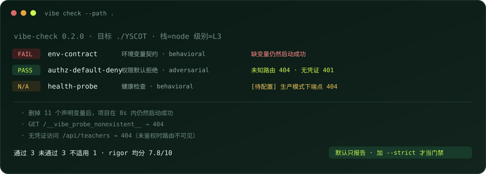

# Vibe Groundwork（vibecoding 工程化底座）

简称 **vibe-Groundwork**。

<div align="center">

<p><strong>把 AI 写出来的项目，从「能跑」验到「能上线」。</strong></p>

<p>
  <a href="https://github.com/jorinyang/vibe-Groundwork/releases"></a>
  <a href="https://www.npmjs.com/package/vibe-groundwork"></a>
  <a href="https://nodejs.org/"></a>
  <a href="LICENSE"></a>
  <a href="#一行跑"></a>
  <a href="#contributing"></a>
</p>



</div>

vibe-Groundwork 是一个面向 vibecoding 项目的 **工程化验收底座**。它不替你写代码，而是把「工程化做完了没有」变成可执行、可复现的判定：

- **判定**：七项能力，真起服务打请求，不看文件在不在；
- **处方**：每条失败都对应可执行动作，agent 能直接照做；
- **协议**：`AGENTS.md` + MCP 三工具，agent 能自己扫、自己修、自己复验。

> Node 22.6+ · 零运行时依赖 · **默认只报告不阻断** · 可接 CI 门禁

---

## 一行跑

```bash
npx vibe-groundwork check --path .
```

不想走 npm 也可以直接从仓库跑：

```bash
npx github:jorinyang/vibe-Groundwork check --path .
```

或者 clone 下来：

```bash
git clone https://github.com/jorinyang/vibe-Groundwork
cd vibe-Groundwork && npm ci && npm run build
node bin/vibe.mjs check --path <你的项目>
```

**默认不会因为失败返回非零** —— 第一次先看清问题；要当门禁再加 `--strict`。

---

## 演示：一次体检怎么跑

真实输出（对象是 `jorinyang/YSCOT`，已配好启动命令，所以行为判定会真的起服务）：

```text
[FAIL] project-constitution   根目录没有 AGENTS.md，agent 每次进场都要重新猜规矩
[FAIL] env-contract           删掉 11 个声明变量后项目仍然启动成功 —— 没有启动校验
                              DEEPSEEK_BASE / DEEPSEEK_MODEL 被代码读取但没声明
[PASS] local-fastcheck        node --check 通过
[N/A ] migration-discipline   项目不碰数据库，正确不适用
[PASS] deploy-discipline      compose 入口 + 部署指南 + 回滚说明
[FAIL] health-probe           GET /api/ping → 404 —— 生产模式下健康端点不可达
[PASS] authz-default-deny     未知路由 404、无凭证访问受保护路由被挡

通过 3  未通过 3  不适用 1  ·  rigor 均分 7.8/10
（未阻断：默认只报告。要当门禁用，加 --strict）
```

三条判定是静态的、四条是真起服务打请求得到的。**同一个项目，静态判定给不出的结论，行为判定给了。**

---

## 为什么做这个

用 AI 写项目，卡点通常不在「能不能实现」，而在**实现完之后那一段**：

- 能跑，但别人克隆下来跑不起来（env、依赖、启动命令没人写）；
- 能改，但改完没人知道有没有改坏（没有 lint、没有测试、没有门禁）；
- 能上线，但上线靠一个 `apply-xxx.sh`，换个人就发不了版；
- 有数据库，但 schema 靠手改，全新环境建不起来库。

vibe-Groundwork 的判断是：**这些都该有一条能跑的判定，而不是一份清单。** 清单只能回答「有没有文件」，判定才能回答「行为对不对」。

| 只查文件会得到 | 实际存在的问题 | 判定查什么 |
| --- | --- | --- |
| 有 `migrations.ts` ✅ | 数组第一项是 `034_...`，第二项才是 `001_core`，全新库先改表后建表，初始化直接失败 | 迁移声明顺序与序号是否单调 |
| 有 `deploy/` 目录 ✅ | 34 个一次性 `apply-*.sh`，没有一条可复现的部署路径 | 一次性脚本数量、可复现入口、回滚路径 |
| 有 `/health` 路由 ✅ | 生产模式下被鉴权中间件挡住，监控永远拿到 404 | 真起服务打一次，看状态码 |

前两条是在真实项目上跑出来的，第三条是配上启动命令后跑出来的。

---

## 七项能力：谁在管什么

| 能力 | 级别 | 判定方式 | 修复风险 | 一句话 |
| --- | --- | --- | --- | --- |
| **`project-constitution`** | L1 | static | green | agent 进仓库能不能一屏知道规矩 |
| **`env-contract`** | L1 | **behavioral** | green | 声明的变量和用到的对不对得上；缺变量会不会快速失败 |
| **`local-fastcheck`** | L2 | behavioral | green | 本地闸门是不是真的在拦 |
| **`migration-discipline`** | L2 | **behavioral** | yellow | schema 能不能从仓库重现，迁移有没有真的落库 |
| **`deploy-discipline`** | L2 | static | yellow | 部署是一条命令，还是一堆一次性脚本 |
| **`health-probe`** | L2 | behavioral | green | 健康检查区不区分「进程活着」和「依赖可用」 |
| **`authz-default-deny`** | L3 | **adversarial** | **red** | 未知路由 404、受保护路由 401、伪造凭证不放行 |

修复风险决定处方能不能自动执行：**green 直接改，yellow 先快照，red 只出 patch**。权限模型永远是 red —— 判错一次会把用户站点锁死。

> `project-constitution` 是唯一只做静态判定的能力：文档质量没有运行时行为可验。它不计入 rigor 均分，但仍然要跑、要显示。

### 三档接入

| 方式 | 场景 | 一条命令 |
| --- | --- | --- |
| **存量接入** | 项目已经写完了 | `vibe check --path .` → `vibe fix --allow-risk green --apply` |
| **新建起步** | 从零开始 | `vibe init --path .` 生成配置与 `AGENTS.md`，从 L2 起步 |
| **CI 门禁** | 防止退化 | `vibe check --path . --strict --json` |

---

## N/A 不是通过

报告把「没验到」拆成两类，绝不混进绿：

| 标记 | 含义 | 报告怎么处理 |
| --- | --- | --- |
| `[不适用]` | 项目根本不需要（不碰数据库、没有 HTTP 服务、没有部署痕迹） | 只计数 |
| `[待配置]` | 缺启动命令或依赖，配好就能验 | 打印 `▸` 逐行配置指引，并在末尾汇总「补一条配置即可」 |

对应的结论也有三档：

```text
结论  3 项能力未通过（5 条规则失败）
结论  没有失败项，但有 2 条未验证（不是通过，是没验）
结论  全部通过（或不适用）
```

**中间那一档是这个项目存在的原因。** 绝大多数体检工具只有「红」和「绿」，而「没测」被悄悄算成了绿。

---

## 一次修复怎么闭环

### 1. 扫出问题

```bash
npx github:jorinyang/vibe-Groundwork check --path ./your-project
```

默认不阻断，先让你看清问题。要进 CI 再加 `--strict`。

### 2. 读一页说明

```bash
vibe explain authz-default-deny
```

每项能力一页：为什么存在、必须达到什么行为、怎么验、常见抄错。

### 3. 按处方修

```bash
vibe fix --path . --allow-risk green          # 只出计划
vibe fix --path . --allow-risk green --apply  # 真改，改前打快照
```

| 风险 | 能力 | 授权方式 |
| --- | --- | --- |
| green | 宪法 / env / 快检 / 健康 | 直接执行 |
| yellow | 迁移 / 部署 | 打快照后执行，部署只出说明 |
| **red** | 权限模型 | **只出 patch，人工执行** |

### 4. 复扫

改完必须复扫，不复扫不算完成。在真实项目的副本上实测：生成 `AGENTS.md`、补齐 11 个环境变量后，宪法从 FAIL 转 PASS。

---

## 架构

```text
Facts（抽取） → Checks（判定） → Findings（发现） → Prescriptions（处方）
```

**栈相关性全部集中在 Facts 一段。** Checks 只消费事实，不碰具体文件 —— 这是「换一门语言不用重写判定」的原因，也是双栈成本不翻倍的关键。

| 层 | 管什么 | 举例 |
| --- | --- | --- |
| **Facts** | 从项目里抽事实（栈相关） | 路由表、env 引用、迁移文件、部署脚本、健康端点 |
| **Checks** | 拿事实判对错（栈无关） | 「未注册路由必须 404」「迁移序号必须单调」 |
| **Findings** | 汇成机器可读报告 | JSON + 人读报告 |
| **Prescriptions** | 每条失败对应可执行处方 | 生成 / 追加 / 打补丁 / 只出说明 |

### 设计取舍

| 取舍 | 选择 | 代价 |
| --- | --- | --- |
| 判定强度 | 能行为判定就不静态判定 | 慢（要起服务）、需要 `.vibe/config.yaml` |
| 默认行为 | 只报告、不阻断 | 想当门禁必须显式 `--strict` |
| 栈支持 | Facts 分层，Checks 共用 | 新语言要补 Facts 适配器，不是零成本 |
| 自动修复 | 只对 green 自动执行 | 覆盖面小，但不会把站点改坏 |
| 规格形态 | `check.yaml` 声明 + 代码实现 | 两者有漂移风险，靠 CI 卡住 |

**当前边界**：Linux / macOS / Windows 都能跑；行为判定需要项目能在本机启动；非 SQLite 数据库暂不支持迁移落库探针。

---

## 目录结构

~~~text
vibe-Groundwork/
├─ bin/
│  ├─ vibe.mjs                   npx 入口（CLI）
│  └─ vibe-mcp.mjs               npx 入口（MCP server）
├─ src/
│  ├─ core/                      类型 / 配置 / 启动器 / 运行器 / 注册表
│  ├─ facts/                     抽取：项目 / env / 路由 / 迁移 / 部署
│  ├─ checks/                    判定：七项，只消费 facts
│  ├─ prescribe/                 处方：计划 / 执行 / 快照 / 风险闸门
│  ├─ report/                    人读报告 + JSON
│  └─ mcp/                       MCP server：scan / fix / explain
├─ capabilities/
│  └─ NN-<id>/                   SPEC.md · check.yaml · prescription.yaml
├─ templates/                    init 用的 AGENTS.md 模板
├─ tests/run.mjs                 判定的正反用例（好项目必须过，坏项目必须挂）
├─ docs/
│  ├─ CONFORMANCE.md             对外一致性规格
│  ├─ HOW-AGENT-WORKS.md         agent 三级自主协议
│  ├─ REPORT-validation.md       9 个真实项目的验证矩阵
│  ├─ REVIEW.md                  Phase 7 审查（对照 + 蓝军）
│  └─ REVIEW-fixes.md            四条 Must Fix 的修复记录
├─ AGENTS.md                     agent 进这个仓库的第一屏
└─ vibe.spec.yaml                机器真源：能力清单与质量门槛
~~~

---

## 文档

- [一致性规格（conformance spec）](docs/CONFORMANCE.md)
- [agent 作业协议](docs/HOW-AGENT-WORKS.md)
- [验证报告：9 个项目、跨 5 种技术栈](docs/REPORT-validation.md)
- [审查报告（含蓝军 6 阶段）](docs/REVIEW.md)
- [Must Fix 修复记录](docs/REVIEW-fixes.md)
- [AGENTS.md](AGENTS.md)

---

## Roadmap

- [x] Facts / Checks 分层，判定不读文件
- [x] 七项能力四件套齐全
- [x] 处方执行：快照 → 执行 → 复扫 → 回滚
- [x] 三级风险闸门（green / yellow / red）
- [x] MCP server：`vibe_scan` / `vibe_fix` / `vibe_explain`
- [x] 默认只报告，`--strict` 才当门禁
- [x] N/A 细分「不适用 / 待配置」+ 配置指引
- [x] 行为判定跑通（env 缺变量快速失败、权限对抗探针、健康端点）
- [x] 9 个真实项目、跨 Node / Python / Go / Ruby / TS 验证
- [x] 发布到 npm registry（`npx vibe-groundwork`）
- [ ] 非 SQLite 数据库的迁移落库探针
- [ ] 误报率的时间趋势（按版本对比）
- [ ] 更多语言 Facts 适配器（Java / C# / PHP）

---

## 版本记录

| 时间 | 内容 |
| --- | --- |
| **v0.2.2** | 修复行为判定的进程生命周期：启动实例由运行器统一关闭，不再残留占端口的孤儿进程；判定之间共享同一个实例 |
| **v0.2.1** | 发布到 npm registry（`npx vibe-groundwork`）；README 补「一行跑」入口 |
| **v0.2.0** | 七项能力（新增部署纪律）；N/A 细分与配置指引；默认非阻断 + `--strict`；行为判定跑通；`npx` 一行跑；样本扩到 9 个项目跨 5 种技术栈 |
| **v0.1.0** | 六项能力；Facts/Checks 分层；处方闭环与风险闸门；MCP server；CI 门禁 |

更详细的变更见 [Releases](https://github.com/jorinyang/vibe-Groundwork/releases)。

---

## Contributing

欢迎 Issue / PR。提交前请确认：

1. `npm ci && npm run build && node tests/run.mjs` 全绿；
2. `node bin/vibe.mjs check --path . --no-behavioral --strict` 通过（自己得先体检合格）；
3. 新增能力必须同时给 `tests/` 的正反用例，且在两个对照项目上跑过；
4. 判定不许依赖外网，不许吞异常，不许新增「只检查文件存在」的判定。

## License

[MIT](LICENSE) © jorinyang
